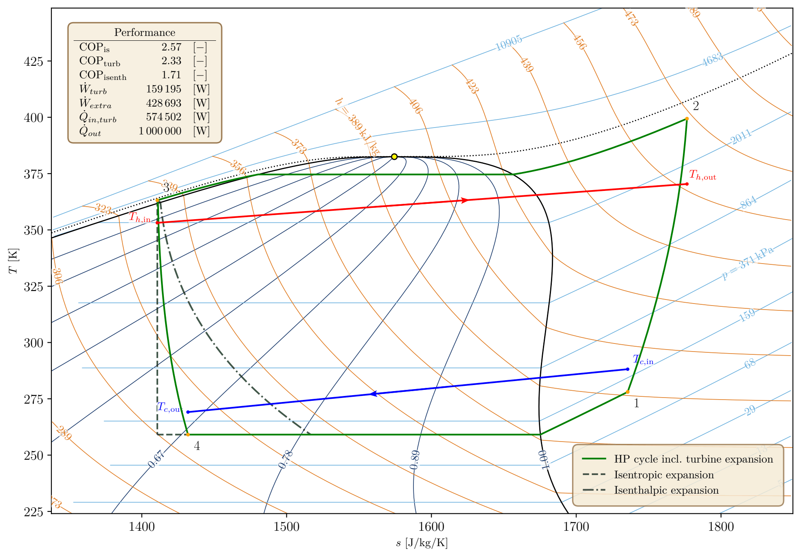
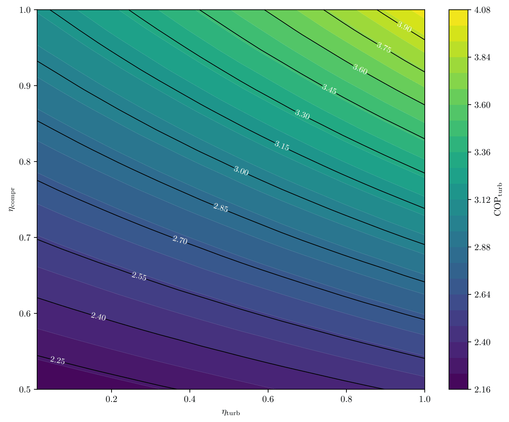

# Conceptual Heat Pump Cycle (CHPC)

This tool identifies the vapour-compression cycle with maximum COP for a given set of heat source and heat sink characteristics, heat exchanger pinch-point constraints, component efficiencies and refrigerant. The cycle is a single-stage vapour-compression cycle in which the expansion valve is replaced by a turbine expander, which delivers its work to the compressor shaft. It follows from a differential evolution optimization of the compressor pressure ratio, the temperature and entropy at the compressor inlet, and the temperature at the condenser outlet, subject to the pinch-point constraints of the evaporator and condenser. The figure below shows the resulting cycle of R1234ze(E), together with the expansion through an isentropic turbine (dashed) and through an expansion valve (dash-dotted). The diagram background is generated with [thermoplot](https://github.com/mths-mhln/thermoplot), of which a local copy is included in `src/thermoplot`.



## Dependencies

- Python 3.13 or newer
- CoolProp, matplotlib, numpy, rich and scipy, see `pyproject.toml`. The exact versions are recorded in `uv.lock`.
- NIST REFPROP. All thermodynamic properties are extracted from REFPROP through CoolProp, hence a REFPROP licence and installation are necessary. The tool does not fall back on the CoolProp equations of state.
- A LaTeX installation, which is used for the text in the diagrams.

## Installation

Clone the repository, create a virtual environment with [uv](https://docs.astral.sh/uv/) and install the tool in editable mode, which makes both `CHPC` and the local copy of `thermoplot` importable:

```bash
git clone https://github.com/mths-mhln/CHPCT.git
cd CHPCT
uv venv
.venv\Scripts\activate
uv pip install -e .
```

On Linux and macOS the environment is activated with `source .venv/bin/activate`. A regular `python -m venv .venv` followed by `pip install -e .` should work as well.

## Source structure

The Python package is organized by responsibility:

| Folder | Contents |
| --- | --- |
| `src/CHPC/cycle_evaluation/` | Thermodynamic cycle solvers and cycle data generation |
| `src/CHPC/post_processing/` | Diagrams and post-processing studies, including the global optimum, perturbation and calculation-method comparisons |
| `src/CHPC/utils/` | Configuration parsing, result serialization and logging |
| `src/CHPC/COP_vs_eff/` | COP versus component-efficiency sweep |

## How to run

Running the tool and post-processing its results are separated. `main.py` runs the analysis specified in the config file at the top of the script, and saves the results as `.npz` files in `results/`. Afterwards, `postprocess.py` makes the diagrams from these files. Both scripts are run from the root of the repository:

```bash
python main.py
python postprocess.py
```

Another analysis is run by changing the `config_file` variable in `main.py`, e.g. `config_file = "config/CO2/CHPC.ini"`, and the path of the results file in `postprocess.py` accordingly. The refrigerant folders in `config/` contain two kinds of config files:

| Config file | Analysis | Results |
| --- | --- | --- |
| `CHPC.ini` | optimizes a single cycle and prints its performance parameters, state points and operating conditions, including the volumetric expansion ratio over the turbine | T-s, p-h and optimizer progress diagrams in `results/heat_pump_thermodynamic_diagrams/<refrigerant>/` |
| `COP_vs_eff.ini` | optimizes the cycle for a grid of turbine and compressor efficiencies | COP maps in `results/COP_investigations/<refrigerant>/` |

For a single cycle, `make_cycle_plots` in `postprocess.py` makes the T-s and p-h diagram of the cycle, as well as the progress of the optimizer. The latter shows the COP of every candidate cycle evaluated by the differential evolution algorithm. Infeasible candidates, e.g. cycles that violate one of the pinch-point constraints, are plotted at a COP of zero. The margins around the cycle and the size of the optimizer progress figure are arguments of `make_cycle_plots`, and the diagram backgrounds are specified in `config/thermoplot/`. `postprocess.py` also contains the empty T-s and p-h diagrams of a substance.


The COP sweep can take a while for a large `n_η`. It saves its progress every 5 cycles, and can be continued after an interruption by running `main.py` again with the same config file. The COP map is made with `make_COP_vs_eff_plot` in `postprocess.py`. The figure below shows the COP map of R1234ze(E).



The cycle calculation method is selected with `calculation_method`. `full_optimization` optimizes the four variables above, `fixed_PR` optimizes the compressor inlet state and the condenser outlet temperature at a given pressure ratio, and `three_temp_fix` fixes four temperature differences and only optimizes the pressure ratio (the implementation is in `src/CHPC/cycle_evaluation/thermodynamics_three_temp_fix.py`). Results of the latter two methods carry the method in their file name, e.g. `COP_vs_eff_R1234ze(E)_COP_turb_three_temp_fix.npz`, such that the methods can be compared with

```bash
python -m CHPC.post_processing.calculation_method_comparison --data-dir "results/COP_investigations/R1234ze(E)/data"
```

Two investigations support the results of the thesis, and are run as modules from the root of the repository. `python -m CHPC.post_processing.global_optimum_check` repeats the optimization of a cycle for several seeds of the differential evolution algorithm, and shows the coverage of the design space by the evaluated candidates. `python -m CHPC.post_processing.perturbation_study` perturbs the cycle specifications of the R1234ze(E), CO2 and MM config files one at a time by -20 % and +20 %, and evaluates the optimal cycle of every configuration in parallel.

Before the analysis, `main.py` can verify the model against pocketTHERM for three heat pump cycles (see `test/system_tests`), which is switched on with `perform_verification=True` at the bottom of `main.py`.

## Input overview

The config file is an `.ini` file with the sections below, see `config/R1234ze(E)/CHPC.ini`. All inputs are in SI units, with temperatures in K. Since keys such as `ṁ_h` and `η_turb` contain special characters, the file has to be saved as UTF-8. Inputs that are not used by the specified analysis type and calculation method must not be specified, e.g. `PR` for `full_optimization`, otherwise an error is raised.

| Input | Unit or values | Description |
| --- | --- | --- |
| **[ANALYSIS TYPE]** | | |
| `analysis_type` | `CHPC` or `COP_vs_eff` | single cycle, or cycles for a grid of efficiencies |
| `calculation_method` | `full_optimization` (default), `fixed_PR` or `three_temp_fix` | cycle calculation method |
| **[ANALYSIS SPECIFICATIONS]** | | |
| `refrigerant` | e.g. `R1234ze(E)`, `CO2` | working fluid, following the CoolProp naming convention |
| `T_h_in` | [K] | inlet temperature of the heat sink |
| `ṁ_h`, `cp_h` | [kg/s], [J/kg/K] | mass flow rate and specific heat capacity of the heat sink |
| `T_c_in` | [K] | inlet temperature of the heat source |
| `ṁ_c`, `cp_c` | [kg/s], [J/kg/K] | mass flow rate and specific heat capacity of the heat source |
| `η_turb`, `η_compr` | [-] | isentropic efficiency of the turbine and compressor, `CHPC` only |
| `η_shaft` | [-] | efficiency of the turbine/compressor shaft connection, default 1 |
| `ΔT_pp_min_evap`, `ΔT_pp_min_cond` | [K] | minimum pinch-point temperature difference in the evaporator and condenser, not for `three_temp_fix` |
| `Q_out_req` | [W] | required heat output, not for `three_temp_fix` |
| `PR` | [-] | compressor pressure ratio, `fixed_PR` only |
| `ΔT_pp_1`, `ΔT_pp_3`, `ΔT_pp_4`, `ΔT_sh` | [K] | temperature difference at the evaporator outlet, condenser outlet and evaporator inlet, and superheat, `three_temp_fix` only |
| **[COP VS EFF SETTINGS]** | | `COP_vs_eff` only |
| `η_turb_bounds`, `η_compr_bounds` | `[min, max]` | bounds of the turbine and compressor efficiency |
| `n_η` | integer, e.g. `20` | number of efficiencies, the bounds included. The COP is evaluated for `n_η` x `n_η` cycles |
| `existing_complete_sweep_action` | `prompt` (default), `abort` or `recompute` | behaviour when a complete sweep already exists |
| **[NUMERICS]** | | |
| `n_pts` | integer, default `150` | number of points along the isobars, used for the heat transfer integration and the diagrams |
