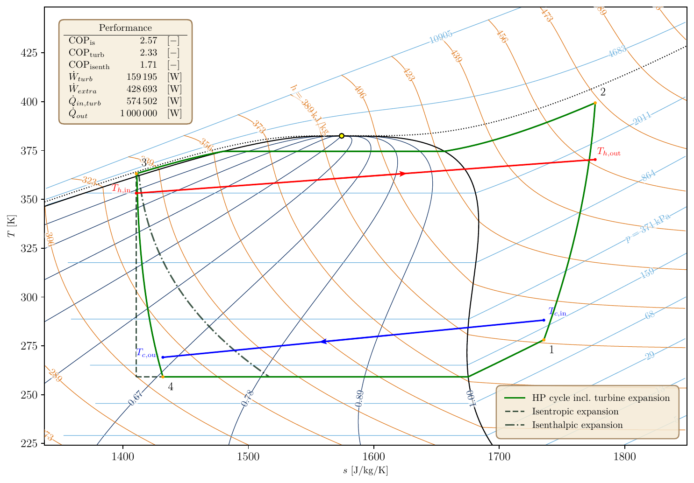
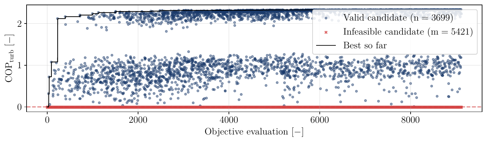
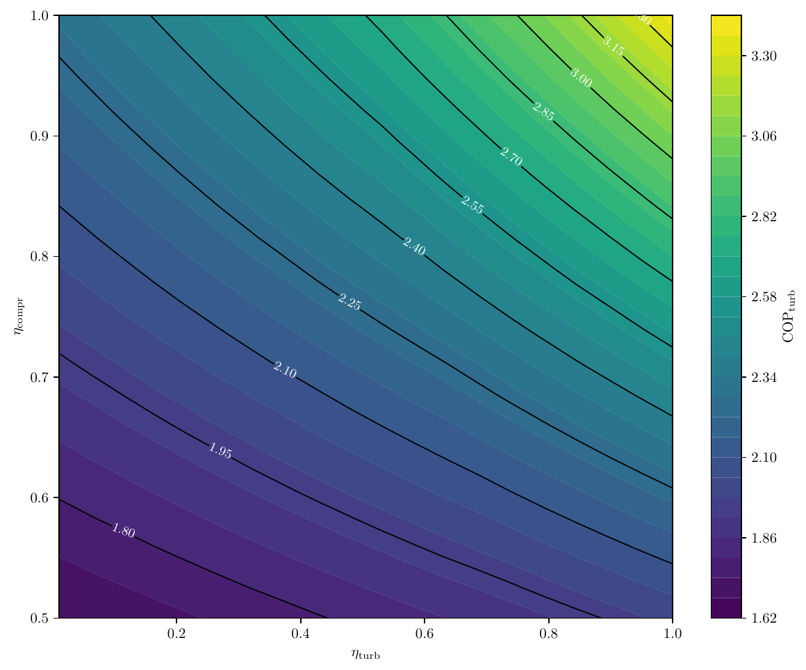

Running the tool
================

Running an analysis and making its diagrams are two separate steps. ``main.py`` runs the analysis of the config file specified at the top of the script, and saves the results as ``.npz`` files in ``results/``. ``postprocess.py`` makes the diagrams from these files afterwards. Both scripts have to be run from the root of the repository:

.. code-block:: bash

   python main.py
   python postprocess.py

Another analysis is run by changing the ``config_file`` variable in ``main.py``, e.g.

.. code-block:: python

   config_file = "config/CO2/CHPC.ini"

and the path of the results file in ``postprocess.py`` accordingly. Every refrigerant folder in ``config/`` contains a ``CHPC.ini`` and a ``COP_vs_eff.ini`` file, which correspond to the two analysis types below.

Single cycle (CHPC)
-------------------

The cycle with the highest COP is determined for the specified turbine and compressor efficiency. The performance parameters, state points and operating conditions of the cycle are printed in the terminal, and the cycle is saved to ``results/heat_pump_thermodynamic_diagrams/<refrigerant>/data/``. ``make_cycle_plots`` in ``postprocess.py`` then makes the T-s and p-h diagram of the cycle, as well as the progress of the optimizer. The T-s diagram of the R1234ze(E) cycle is shown below. The dashed and dash-dotted lines show the expansion through an isentropic turbine and through an expansion valve respectively.

   T-s diagram of the optimal R1234ze(E) cycle.

The optimizer progress shows the COP of every candidate cycle evaluated by the differential evolution algorithm. Infeasible candidates, e.g. cycles that violate one of the pinch-point constraints, are plotted at a COP of zero.

   Optimizer progress of the R1234ze(E) cycle.

COP versus component efficiency (COP_vs_eff)
--------------------------------------------

The cycle is optimized for a grid of turbine and compressor efficiencies, which can take a while for a large ``n_η``. The progress is saved every 5 cycles, so an interrupted sweep can be continued by running ``main.py`` again with the same config file. The COP map is made with ``make_COP_vs_eff_plot`` in ``postprocess.py``, and saved to ``results/COP_investigations/<refrigerant>/``.

   COP of the CO2 cycle as a function of the turbine and compressor efficiency.

Verification
------------

Before the analysis, ``main.py`` can verify the model against pocketTHERM for three heat pump cycles. This is switched on with ``perform_verification=True`` in the call to ``main`` at the bottom of the script. The verification cases can be found in ``test/system_tests``.
